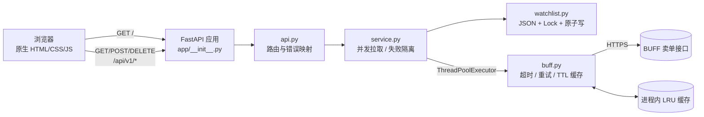

# csgoMarket

一个本地运行的网易 BUFF 饰品价格监控工具：把关注的饰品放在一个列表里，一次看清 BUFF 最低在售价、Steam 参考价、价差、在售数量与前五条卖单。

后端是 FastAPI，前端是零依赖的原生 HTML/CSS/JS，没有 CDN、没有构建步骤、不需要数据库。关注列表保存在一个 JSON 文件里，随时可以备份或手改。

> 这是 2023 年小项目的重构版本。接口与响应格式已全部更新，旧路径 `/buff/{id}`、`/submit/{id}`、`/get` 已移除，迁移方式见[旧接口迁移](#旧接口迁移breaking-change)。

## 功能

- 关注任意 BUFF 商品，按关注顺序展示行情
- 并发拉取关注列表，单个商品失败不影响其他商品
- BUFF 最低价、Steam 参考价、价差百分比（低于 Steam 为绿色，高于为红色）
- 前五条卖单价格，卖单不足五条或为零时不报错
- 30 秒进程内 TTL 缓存，手动刷新可绕过
- 超时、连接失败、5xx、429 自动重试并给出明确的中文错误
- 关注列表原子写入、线程安全、去重、上限保护
- 首次启动自动迁移旧版 `script/submit.buff`
- 深色监控页，支持移动端横向滚动、加载骨架、错误重试与空状态

## 架构



一次 `/api/v1/watchlist` 请求的流程：

1. `WatchlistStore` 在锁内读出关注列表快照。
2. `WatchlistService` 用线程池并发调用 `BuffClient`，默认 6 个 worker。
3. 每个商品独立捕获异常，失败项进入 `failed`，成功项保持原顺序。
4. `BuffClient` 命中 TTL 缓存则不发请求；未命中则带超时和重试访问 BUFF。
5. 响应统一为 JSON，耗时用 `time.perf_counter()` 统计。

## 目录结构

```text
csgoMarket/
├── app/
│   ├── __init__.py          # create_app() 工厂、lifespan、中间件、静态资源
│   ├── main.py              # uvicorn 入口：app = create_app()
│   ├── config.py            # 环境变量配置（不可变 dataclass）
│   ├── buff.py              # BUFF 客户端：超时/重试/缓存/归一化
│   ├── watchlist.py         # 关注列表：锁、原子写、去重、迁移
│   ├── service.py           # 并发拉取与失败隔离
│   ├── schemas.py           # pydantic v2 模型与 ID 校验
│   ├── api.py               # /api/v1/*、/healthz、/
│   ├── static/              # style.css、app.js
│   └── templates/           # index.html（Jinja2）
├── data/
│   └── watchlist.example.json
├── script/
│   └── submit.buff          # 旧版关注列表，保留用于一次性迁移
├── scripts/
│   └── import_watchlist.py  # 手动迁移脚本（幂等）
├── tests/                   # pytest，全部 mock 网络
├── .github/workflows/ci.yml # Python 3.12/3.13 lint + test
├── pyproject.toml
├── requirements.txt
└── uv.lock
```

运行期生成的 `data/watchlist.json`、日志与缓存目录都已加入 `.gitignore`。

## 快速开始

需要 Python ≥ 3.12 与 [uv](https://docs.astral.sh/uv/)：

```bash
uv venv --python 3.12
uv pip install -e '.[dev]'
uv run uvicorn app.main:app --reload --port 8000
```

打开 <http://127.0.0.1:8000>。首次启动会从 `script/submit.buff` 自动迁移旧关注列表（如果 `data/watchlist.json` 不存在）。

不想用 uv 也可以用 pip：

```bash
python -m venv .venv && source .venv/bin/activate
pip install -r requirements.txt
uvicorn app.main:app --port 8000
```

不访问真实商品也能验证服务是否启动：

```bash
curl http://127.0.0.1:8000/healthz
# {"status":"ok","watchlist_count":6,"cache_entries":0}
```

> 添加商品和拉取行情需要访问 `buff.163.com`。测试套件不访问外网。

## 配置

全部通过环境变量配置，非法值会在启动时抛出带中文说明的 `ConfigError`。

| 变量 | 默认值 | 说明 |
| --- | --- | --- |
| `CSGO_WATCHLIST_PATH` | `data/watchlist.json` | 关注列表路径；相对路径相对项目根目录 |
| `CSGO_CACHE_TTL` | `30` | 行情缓存秒数，`0` 表示关闭缓存，上限 3600 |
| `CSGO_HTTP_TIMEOUT` | `5,10` | BUFF 请求超时；`5,10` 表示连接 5 秒、读取 10 秒，单个数字表示两者相同 |
| `CSGO_MAX_WORKERS` | `6` | 并发拉取 worker 数，1–32 |
| `CSGO_CORS_ORIGINS` | 空 | 逗号分隔的允许来源；留空表示不启用 CORS |
| `BUFF_COOKIE` | 空 | 可选的 BUFF Cookie，遇到风控时可透传浏览器 Cookie |
| `CSGO_MAX_ITEMS` | `200` | 关注列表上限，1–2000 |

示例：

```bash
CSGO_CACHE_TTL=60 \
CSGO_HTTP_TIMEOUT=5,15 \
CSGO_MAX_WORKERS=8 \
BUFF_COOKIE='session=...' \
uv run uvicorn app.main:app --port 8000
```

## API 文档

统一约定：

- 成功响应为 JSON；`DELETE` 成功返回 `204` 无响应体。
- 所有错误都是 `{"detail": "中文说明"}`，包括 422 参数校验错误。
- 时间字段为 UTC ISO 8601，例如 `2026-11-18T09:30:00Z`。
- `goods_id` 必须是 1–12 位纯数字。

### `GET /api/v1/goods/{goods_id}`

获取单个商品的最新行情。

```bash
curl 'http://127.0.0.1:8000/api/v1/goods/42235'
```

```json
{
  "goods_id": "42235",
  "name": "USP消音版 | 力矩 (略有磨损)",
  "steam_price_cny": 8.26,
  "buff_min_price": 7.0,
  "sell_count": 91,
  "top_prices": [7.0, 7.0, 7.2, 7.5, 7.8],
  "icon_url": "https://market.fp.ps.netease.com/file/...",
  "fetched_at": "2026-11-18T09:30:00Z",
  "cached": false
}
```

| 情况 | 状态码 | `detail` |
| --- | --- | --- |
| 商品不存在 / BUFF `code != "OK"` | 404 | `未找到该商品` |
| 超时、连接失败、重试耗尽 | 504 | `访问 BUFF 超时，请稍后重试` |
| BUFF 返回 429 | 503 | `BUFF 暂时限制访问，请稍后重试` |
| 上游结构异常、非 JSON | 502 | `BUFF 返回数据异常` |
| `goods_id` 格式非法 | 422 | `商品 ID 必须是 1–12 位纯数字。` |

`top_prices` 最多五条；卖单为 0 条时是 `[]`，`buff_min_price` 会回退到 `sell_min_price`。

### `GET /api/v1/watchlist?refresh=false`

并发拉取全部关注。`refresh=true` 跳过缓存重新请求 BUFF。

```bash
curl 'http://127.0.0.1:8000/api/v1/watchlist'
curl 'http://127.0.0.1:8000/api/v1/watchlist?refresh=true'
```

```json
{
  "count": 2,
  "items": [
    {
      "goods_id": "42235",
      "name": "USP消音版 | 力矩 (略有磨损)",
      "steam_price_cny": 8.26,
      "buff_min_price": 7.0,
      "sell_count": 91,
      "top_prices": [7.0, 7.05, 7.2, 7.47, 7.47],
      "icon_url": "https://...",
      "fetched_at": "2026-11-18T09:30:00Z",
      "cached": false
    }
  ],
  "failed": [
    {"goods_id": "35283", "reason": "超时"}
  ],
  "took_ms": 320.5,
  "fetched_at": "2026-11-18T09:30:00Z"
}
```

- `count` 是本次涉及的商品总数（成功 + 失败）。
- `items` 保持关注列表原顺序；失败项不会出现在 `items` 中。
- `failed[].reason` 取值为 `未找到该商品`、`超时`、`BUFF 暂时限制访问`、`BUFF 返回数据异常`、`获取失败`。
- 即使所有商品都失败，接口仍返回 200。

### `POST /api/v1/watchlist`

先校验格式，再向 BUFF 确认商品存在，最后落盘。`goods_id` 同时接受字符串和 JSON 数字。

```bash
curl -X POST 'http://127.0.0.1:8000/api/v1/watchlist' \
  -H 'Content-Type: application/json' \
  -d '{"goods_id": "42235"}'
```

```json
{
  "goods_id": "42235",
  "added_at": "2026-11-18T09:30:00Z"
}
```

| 情况 | 状态码 | `detail` |
| --- | --- | --- |
| 成功 | 201 | — |
| 已存在 | 409 | `该商品已在关注列表中` |
| 超过上限 | 409 | `关注列表已满（上限 200）` |
| 商品不存在 | 404 | `未找到该商品` |
| 格式非法 | 422 | `商品 ID 必须是 1–12 位纯数字。` |

并发提交同一 ID 时，存储层用锁和精确字符串比较去重，只会落一条记录。

### `DELETE /api/v1/watchlist/{goods_id}`

```bash
curl -X DELETE 'http://127.0.0.1:8000/api/v1/watchlist/42235'
# HTTP/1.1 204 No Content
```

不存在时返回 404：`{"detail":"该商品不在关注列表中"}`。

### `GET /healthz`

```bash
curl 'http://127.0.0.1:8000/healthz'
```

```json
{"status": "ok", "watchlist_count": 6, "cache_entries": 0}
```

### `GET /`

返回监控页（`app/templates/index.html`），静态资源位于 `/static/*`。

## 前端说明

- 纯原生 HTML/CSS/JS，不加载 layui、jQuery 或任何 CDN。
- 表格列：图标、名称、BUFF 最低价、Steam 参考价、价差、在售数量、前五卖单、行情时间、删除。
- 价差为 BUFF 相对 Steam 的百分比；低于 Steam 显示绿色，高于显示红色。
- 所有接口文本通过 `textContent` 写入 DOM，不使用 `innerHTML` 拼接未转义数据。
- `fetch` 使用 `AbortController`，8 秒超时；加载时有骨架屏或按钮忙碌态。
- 错误横幅支持重试；空列表有引导文案；失败项单独列出商品 ID 与原因。
- 添加成功后立即刷新；删除前有确认；窄屏下表格可横向滚动。
- 页脚标注「数据来自网易 BUFF，仅供参考」。

## 旧接口迁移（Breaking Change）

旧版接口全部移除，没有兼容层。对照表：

| 旧接口 | 新接口 | 说明 |
| --- | --- | --- |
| `GET /buff/{goods_id}` | `GET /api/v1/goods/{goods_id}` | 响应从中文键改为固定字段，价格从字符串改为数字 |
| `POST /submit/{goods_id}` | `POST /api/v1/watchlist` | 商品 ID 改放 JSON 请求体 |
| `GET /get` | `GET /api/v1/watchlist` | 从 `{"0": {...}}` 改为 `items` 数组 + `count`/`failed`/`took_ms` |
| `GET /templates/*` | `GET /static/*` | 不再暴露整个模板目录与 layui 源码 |

关注数据迁移：

- 首次启动时，如果 `data/watchlist.json` 不存在且 `script/submit.buff` 存在，会自动迁移（逐行 `strip`、只保留 1–12 位纯数字、去重）。
- 也可以手动执行，效果相同且幂等：

```bash
uv run python scripts/import_watchlist.py
```

旧文件 `script/submit.buff` 原样保留在仓库中，迁移完成后可以自行删除。

## 测试与 CI

```bash
uv run ruff check .
uv run pytest -q
```

- 123 个用例（含参数化），覆盖客户端解析/重试/缓存、关注列表并发与原子写、service 失败隔离与顺序、API 契约与错误映射、配置校验。
- 测试全部使用伪 Session / 伪客户端，**不会访问 `buff.163.com`**。
- CI 在 Python 3.12 与 3.13 上执行 `pip install -e '.[dev]'`、`ruff check .`、`pytest -q`。

## BUFF 风控与稳定性

- 每次请求都带浏览器 UA 与 `referer: https://buff.163.com/goods/<id>`。
- 连接 5 秒、读取 10 秒超时；连接错误、超时、HTTP 429、5xx 最多重试 2 次，退避 0.3s、0.6s。
- 默认 30 秒缓存，避免刷新页面就重复打接口；`refresh=true` 或过期后才会重新请求。
- 关注列表并发拉取（默认 6 个 worker），单个商品超时不会卡住整个请求。
- BUFF 可能返回 429 或临时风控，此时接口返回 503，前端会提示稍后重试。
- 如果本机 IP 被风控，可在浏览器登录 BUFF 后复制 Cookie，通过 `BUFF_COOKIE` 透传；不要提交或分享自己的 Cookie。
- 请勿调低 `CSGO_CACHE_TTL` 后高频轮询，也不要部署成公开的公共查询服务。

## 免责声明

- 本项目仅用于学习和个人研究，与网易、BUFF、Valve 均无关联。
- 所有价格数据来自第三方（网易 BUFF），可能存在延迟、缺失或错误，仅供参考，不构成任何交易建议。
- 请遵守 BUFF 的服务条款与 robots 约定，控制请求频率；因使用本项目产生的任何后果由使用者自行承担。
- 本项目按 MIT License 发布，不提供任何形式的担保。

## License

[MIT](LICENSE) © 2023 xiao0ne
